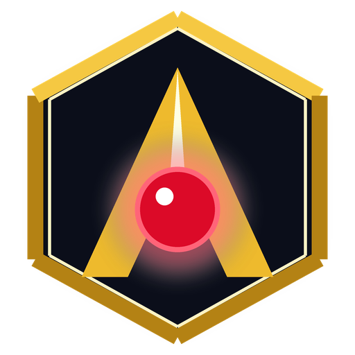

<div align="center">

  

  # 🎬 AabSara (আবসারা)
  ### The Ultimate 4K@120FPS Screen Recorder, RTMP Live Streamer & Video Editor Suite

  <p align="center">
    <b>Every premium feature of Action!, Bandicam, and Camtasia — 100% Free, Open Source, and Lightweight.</b>
  </p>

  [](https://github.com/CyberPrince-glitch/AabSara/releases/latest)
  [](LICENSE)
  [](#-downloads)
  [](https://tauri.app)
  [-345D9D?style=for-the-badge&logo=litecoin&logoColor=white)](#-support-the-creator-litecoin-ltc)

  ---

  <h3>
    <a href="https://cyberprince-glitch.github.io/AabSara/">🌐 Official Website &amp; Landing Page</a>
    <span> · </span>
    <a href="https://github.com/CyberPrince-glitch/AabSara/releases/latest">📥 Download Now</a>
    <span> · </span>
    <a href="#-key-features">✨ Features</a>
    <span> · </span>
    <a href="#-comparison-matrix">📊 Comparison</a>
    <span> · </span>
    <a href="#-support-the-creator-litecoin-ltc">🪙 Donate (LTC)</a>
  </h3>

  ---
</div>

<br/>

## 🌟 What is AabSara?

**AabSara** is a state-of-the-art screen recording, game capture, RTMP live streaming, and video editing workstation crafted with **Rust**, **Tauri v2**, **React 19**, and **TypeScript**. 

Traditional screen recorders like Mirillis Action! and Bandicam charge \$35–\$50/year, watermark your clips, or choke low-spec laptops with 500MB+ of background RAM bloat. Camtasia charges \$299 upfront.

**AabSara changes that forever.** It brings cinema-grade 4K@120FPS GPU encoding, multi-track audio, live webcam chroma-key (green screen), RTMP broadcasting, and a native Android companion app — with **zero subscriptions, zero watermarks, and zero compromises**.

---

## 📥 Downloads

Grab the latest production binaries directly from our [GitHub Releases](https://github.com/CyberPrince-glitch/AabSara/releases/latest):

| Platform | Format | File Size | Description | Download |
| :--- | :--- | :--- | :--- | :--- |
| **Windows 10 / 11** | Installer (`.exe`) | **~2.26 MB** | Full setup wizard, start menu & desktop shortcuts | [**Download Installer**](https://github.com/CyberPrince-glitch/AabSara/releases/download/v1.0.0/AabSara_Installer.exe) |
| **Windows 10 / 11** | Portable (`.exe`) | **~6.41 MB** | Standalone binary. Zero installation, run anywhere | [**Download Portable**](https://github.com/CyberPrince-glitch/AabSara/releases/download/v1.0.0/AabSara_Portable.exe) |
| **Android 8.0+** | Package (`.apk`) | **~12.2 MB** | Optimized mobile app (`arm64-v8a`) with responsive UI | [**Download APK**](https://github.com/CyberPrince-glitch/AabSara/releases/download/v1.0.0/AabSara_v1.0.0_arm64.apk) |
| **Linux (Ubuntu/Debian)** | Package (.deb) | **~3.42 MB** | Native Debian/Ubuntu package (dpkg -i) | [**Download DEB**](https://github.com/CyberPrince-glitch/AabSara/releases/download/v1.0.0/AabSara_1.0.0_amd64.deb) |
| **Linux (Universal)** | Portable (.AppImage) | **~78.2 MB** | Standalone portable executable for all Linux distributions | [**Download AppImage**](https://github.com/CyberPrince-glitch/AabSara/releases/download/v1.0.0/AabSara_1.0.0_amd64.AppImage) |
| **macOS (Apple Silicon)** | Disk Image (.dmg) | **~2.78 MB** | Drag-and-drop installer for M1/M2/M3/M4 Apple Macs | [**Download DMG**](https://github.com/CyberPrince-glitch/AabSara/releases/download/v1.0.0/AabSara_1.0.0_aarch64.dmg) |

---

## ✨ Key Features

### 🖥️ Ultra-Low Overhead GPU Screen & Game Capture
- **Hardware Encoders**: Native support for **NVIDIA NVENC**, **AMD AMF**, and **Intel QuickSync (QSV)** for near-zero CPU hit during gameplay.
- **High Frame Rates**: Record silky-smooth **60 FPS, 120 FPS, and up to 240 FPS** in Full HD and **4K UHD**.
- **Display Duplication & Window Capture**: Record full monitors, individual program windows, or custom snipped screen regions.

### 📡 Multi-Platform RTMP Live Streaming
- Broadcast directly to **YouTube Live**, **Twitch**, and **Facebook Live**.
- Robust reconnect engine with live bitrate telemetry, FPS counter, dropped-frame protection, and stream duration counter.

### 🎙️ Multi-Track Audio Engine
- Record system sounds (WASAPI loopback) and microphone audio on separate channels.
- Real-time stereo audio level meters (dBVU gauges) with gain controls.

### 🟢 Studio WebCam & Chroma-Key (Green Screen)
- Seamless real-time green screen removal with configurable similarity and smoothness thresholds.
- Picture-in-Picture webcam overlay with circular, square, and rounded borders.
- Interactive positioning directly over the canvas preview.

### ✂️ Integrated Video Editor & Trimmer
- Trim, cut, preview, and re-export recordings without launching heavy third-party NLE software.
- High-speed remuxing and lossless export.

### 📱 100% Mobile Responsive Android Companion
- Native Android app powered by Tauri v2 and Rust cdylib.
- Fluid mobile responsive layout adapting from 4K desktop ultrawides down to phone screens.

---

## 📊 Comparison Matrix

See how AabSara outperforms expensive commercial screen recording suites:

| Feature | **AabSara** | Mirillis Action! | Bandicam | TechSmith Camtasia | OBS Studio |
| :--- | :---: | :---: | :---: | :---: | :---: |
| **Price** | **100% FREE** | \$37.95 / year | \$44.95 / year | \$299.00 | Free |
| **Watermarks** | **None. Ever.** | On free version | On free version | On free version | None |
| **GPU Hardware Encoding** | **NVENC / AMF / QSV** | Yes | Yes | Limited | Yes |
| **4K @ 120+ FPS Recording** | **Yes** | Yes | Yes | No (60 FPS max) | Yes |
| **Built-in Video Trimmer** | **Yes** | Yes (basic) | Bandicut (Paid \$29) | Yes | No |
| **Green Screen Chroma Key** | **Yes (Built-in)** | Yes | No | Yes | Plugin/Filter |
| **RTMP Live Streaming** | **Yes** | Yes | No | No | Yes |
| **Android APK App** | **Yes (Native arm64)** | No | No | No | No |
| **RAM Footprint** | **~45 - 65 MB** | ~180 MB | ~150 MB | ~850 MB+ | ~300 - 500 MB |
| **Open Source (MIT)** | **Yes** | No | No | No | Yes (GPL) |

---

## 🛠️ Architecture & Tech Stack

```
   ┌────────────────────────────────────────────────────────┐
   │                  AabSara Desktop & Mobile              │
   ├────────────────────────────────────────────────────────┤
   │  Frontend UI: React 19 + TypeScript + Vite + Tailwind  │
   │  Fluid Canvas Compositor · Audio Visualizer · Editor   │
   ├───────────────────────────┬────────────────────────────┤
   │      Tauri v2 IPC         │       WebView2 / JNI       │
   ├───────────────────────────┴────────────────────────────┤
   │  Backend Engine: Rust Core (src-tauri)                 │
   │  ├─ DXGI / WASAPI Low-Latency Desktop Capture          │
   │  ├─ FFmpeg Hardware Acceleration Pipeline (NVENC/AMF)  │
   │  ├─ RTMP Streaming Engine & Connection Manager         │
   │  └─ Native Android jniLibs / libaabsara_lib.so         │
   └────────────────────────────────────────────────────────┘
```

- **Frontend**: [React 19](https://react.dev/), [TypeScript](https://www.typescriptlang.org/), [Vite 8](https://vitejs.dev/), Lucide Icons
- **Desktop Runtime**: [Tauri v2](https://v2.tauri.app/) (Rust 1.85+, WebView2 on Windows)
- **Mobile Engine**: Android NDK 26.1, SDK API 36, Kotlin 2.2, Android Gradle Plugin 9.3
- **Media Pipeline**: Hardware accelerated FFmpeg (H.264, HEVC/H.265, AV1, AAC)

---

## 🚀 Building from Source

### Prerequisites
1. **Node.js** (v18 or higher) & `npm`
2. **Rust** toolchain:
   ```powershell
   rustup default stable
   ```
3. **FFmpeg** installed and accessible in your system `PATH`.

### Clone & Run Desktop App
```bash
# 1. Clone repository
git clone https://github.com/CyberPrince-glitch/AabSara.git
cd AabSara

# 2. Install dependencies
npm install

# 3. Launch live development mode
npm run tauri dev

# 4. Compile optimized Windows release binaries
npm run tauri build
```

### Build Android APK
```powershell
# Set Android environment
$env:ANDROID_HOME = "D:\01-Development\AI-ML\android-build-tools\android-sdk"
$env:NDK_HOME = "D:\01-Development\AI-ML\android-build-tools\android-sdk\ndk\26.1.10909125"

# Compile Android arm64-v8a APK
cd src-tauri\gen\android
.\gradlew assembleArm64Release --no-configuration-cache
```

---

## 🪙 Support the Creator (Litecoin LTC)

AabSara is 100% free and open source. We do not run ads, collect user telemetry, sell commercial tiers, or charge subscriptions.

If AabSara saves you money and helps your content creation or game streams, you can support the solo developer directly with **zero middleman fees** via **Litecoin (LTC)**:

<div align="center">
  <br/>
  <table>
    <tr>
      <td align="center">
        <b>Official Litecoin (LTC) Address</b><br/><br/>
        <code>LKbYGyKFQsMtxP4ezZky5Q2DPMbGxqKKyp</code><br/><br/>
        <i>100% of all contributions go directly toward hardware testing, GPU optimizations, and open-source development.</i>
      </td>
    </tr>
  </table>
  <br/>
</div>

---

## 📄 License

Distributed under the **MIT License**. Free for personal, educational, commercial, and streaming use. See [`LICENSE`](LICENSE) for details.

---

<div align="center">
  <b>Made with ❤️ by Cyber Prince (<a href="https://github.com/CyberPrince-glitch">@CyberPrince-glitch</a>)</b><br/>
  <i>Empowering creators worldwide with free, uncompromised screen recording tools.</i>
</div>
