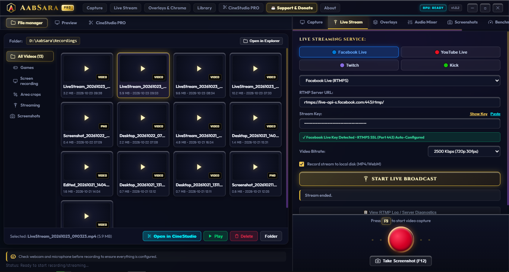
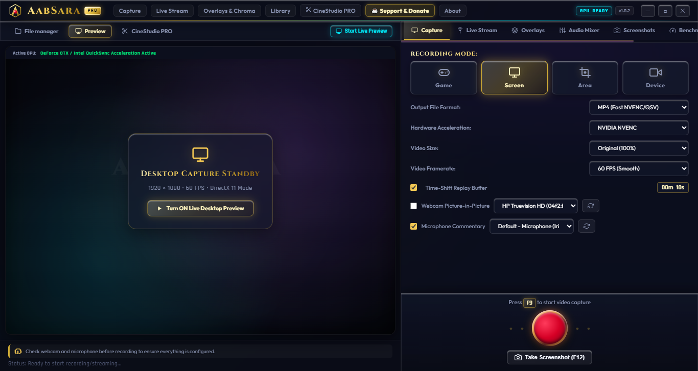
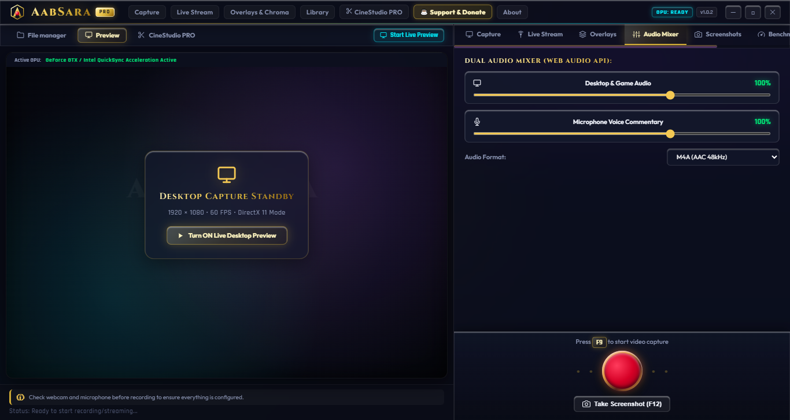
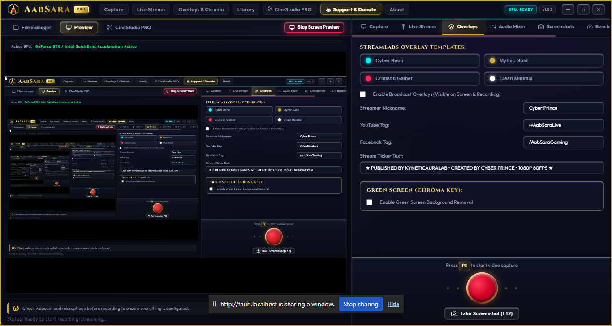
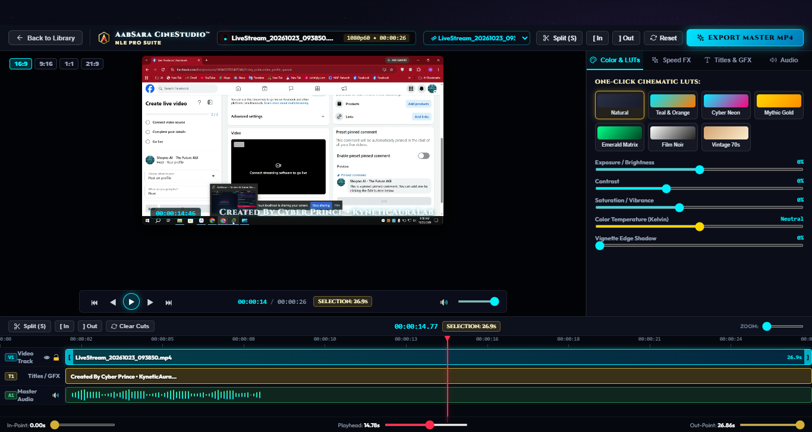
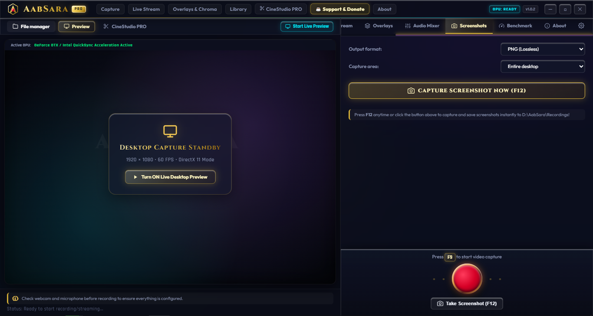
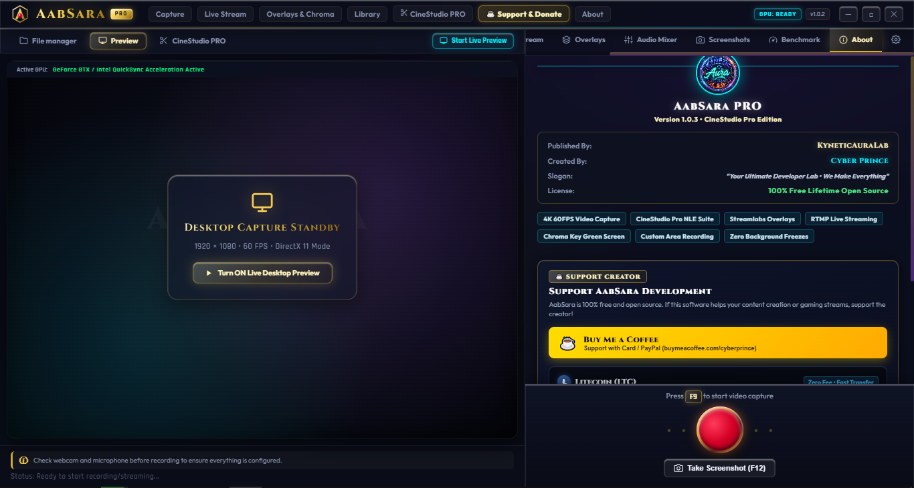

<div align="center">

  

  # 🎬 AabSara (আবসারা)
  ### Next-Gen 4K@120FPS Screen Recorder, RTMP Live Streamer & Video Editing Suite

  <p align="center">
    <b>Every premium feature of Mirillis Action!, Bandicam, and Camtasia — 100% Free, Open Source, and Ultra-Lightweight.</b><br/>
    <i>Zero Watermarks · Zero Subscriptions · Zero Telemetry · Native Desktop & Android</i>
  </p>

  [](https://github.com/CyberPrince-glitch/AabSara/releases/latest)
  [](LICENSE)
  [](#-official-downloads)
  [](https://v2.tauri.app)
  [-345D9D?style=for-the-badge&logo=litecoin&logoColor=white)](#-support-the-creator-litecoin-ltc)

  ---

  <h3>
    <a href="https://cyberprince-glitch.github.io/AabSara/">🌐 Official Website</a>
    <span> · </span>
    <a href="#-official-downloads">📥 Downloads</a>
    <span> · </span>
    <a href="#-visual-interface-tour">📸 Screenshots</a>
    <span> · </span>
    <a href="#-key-features">✨ Features</a>
    <span> · </span>
    <a href="#-industry-comparison-matrix">📊 Comparison</a>
    <span> · </span>
    <a href="#-building-from-source">🛠️ Build from Source</a>
    <span> · </span>
    <a href="#-support-the-creator-litecoin-ltc">🪙 Donate (LTC)</a>
  </h3>

  ---

  <p align="center">
    
  </p>

</div>

<br/>

## 🌟 Overview: What is AabSara?

**AabSara** is a high-performance, hardware-accelerated screen recorder, gameplay capture system, RTMP live streaming broadcaster, and video editor designed for creators, gamers, educators, and developers. Built from the ground up using **Rust**, **Tauri v2**, **React 19**, and **TypeScript**, AabSara delivers studio-grade performance with an extraordinarily low resource footprint (~50MB RAM idle vs 400MB+ in legacy suites).

### 💡 Why AabSara Exists

- **Commercial Recorders are Expensive and Bloated**: Tools like *Mirillis Action!* and *Bandicam* charge \$35–\$50 per year, enforce trial watermarks, or lock hardware encoders behind paywalls. *TechSmith Camtasia* costs \$299.
- **OBS Studio is Powerful but Overkill for Quick Tasks**: While OBS is an industry standard, setting up scenes, audio loopback sinks, and output encoders for simple game recordings or quick tutorials requires steep learning curves and consumes hundreds of megabytes of RAM.
- **AabSara Solves Both**: A complete, single-executable workstation that boots in milliseconds, records 4K at 120+ FPS with hardware GPU acceleration (NVIDIA NVENC, AMD AMF, Intel QSV), mixes multi-track audio, removes webcam backgrounds via green screen, broadcasts to YouTube/Twitch, trims recordings in-app, and includes a native Android companion app.

---

## 📥 Official Downloads

Grab the latest production binaries directly from our [GitHub Releases](https://github.com/CyberPrince-glitch/AabSara/releases/latest):

| Platform / Operating System | Package Type | File Size | Description | Download Link |
| :--- | :--- | :---: | :--- | :--- |
| **Windows 10 / 11 (x64)** | Setup Installer (`.exe`) | **~2.26 MB** | Full installer with Desktop & Start Menu integration | [**Download Installer**](https://github.com/CyberPrince-glitch/AabSara/releases/download/v1.0.0/AabSara_Installer.exe) |
| **Windows 10 / 11 (x64)** | Portable (`.exe`) | **~6.41 MB** | Standalone single binary. Zero installation, run anywhere | [**Download Portable**](https://github.com/CyberPrince-glitch/AabSara/releases/download/v1.0.0/AabSara_Portable.exe) |
| **macOS (Apple Silicon)** | Disk Image (`.dmg`) | **~2.78 MB** | Universal drag-and-drop DMG for M1, M2, M3, and M4 Macs | [**Download DMG**](https://github.com/CyberPrince-glitch/AabSara/releases/download/v1.0.0/AabSara_1.0.0_aarch64.dmg) |
| **Linux (Ubuntu / Debian)** | Package (`.deb`) | **~3.42 MB** | Native Debian/Ubuntu package (`sudo dpkg -i`) | [**Download DEB**](https://github.com/CyberPrince-glitch/AabSara/releases/download/v1.0.0/AabSara_1.0.0_amd64.deb) |
| **Linux (Universal)** | Standalone (`.AppImage`) | **~78.2 MB** | Portable AppImage executable for all Linux distributions | [**Download AppImage**](https://github.com/CyberPrince-glitch/AabSara/releases/download/v1.0.0/AabSara_1.0.0_amd64.AppImage) |
| **Android 8.0+** | Native APK (`arm64-v8a`) | **~12.2 MB** | Mobile responsive recording & streaming app for phones/tablets | [**Download APK**](https://github.com/CyberPrince-glitch/AabSara/releases/download/v1.0.0/AabSara_v1.0.0_arm64.apk) |

---

## 📸 Visual Interface Tour

Experience the clean, modern liquid-glass interface of AabSara across each core workflow:

### 1. 🖥️ Unified Studio Workspace
The central command center with real-time video canvas preview, live session telemetry, hardware status indicators, and one-click quick actions.

<p align="center">
  
</p>

---

### 2. 🎬 4K@120FPS GPU Hardware Recording
Direct hardware encoding with **NVIDIA NVENC**, **AMD AMF**, and **Intel QuickSync (QSV)**. Switch between full monitors, dedicated game windows, or custom screen regions with zero frame drops.

<p align="center">
  
</p>

---

### 3. 🎚️ Multi-Track Pro Audio Mixer
Discrete audio channels for WASAPI desktop loopback (game and system sounds) and microphone input. Includes real-time stereo dBVU peak meters and granular gain control.

<p align="center">
  
</p>

---

### 4. 🟢 Real-Time Chroma-Key (Green Screen) WebCam
Live webcam background subtraction with adjustable similarity and smoothness thresholds. Place circular or rectangular PIP overlays anywhere over your screen or gameplay.

<p align="center">
  
</p>

---

### 5. ✂️ Integrated Lossless Video Trimmer
Trim and clip your recordings immediately inside AabSara without launching heavy third-party NLEs. Non-destructive scrubber with frame-by-frame preview and instant export.

<p align="center">
  
</p>

---

### 6. 📸 Precision Screen Snipper & Annotation
Capture full displays, active application windows, or rectangular snips with instant lossless PNG preview and one-click clipboard copying.

<p align="center">
  
</p>

---

### 7. ℹ️ 100% Free, Open Source & Litecoin (LTC) Support
Zero account registration, zero subscription lockouts, and zero telemetry tracking. Includes direct 1-click Litecoin (LTC) peer-to-peer creator support with zero intermediary fees.

<p align="center">
  
</p>

---

## ✨ Key Features Breakdown

### 🎮 Ultra-Low Overhead GPU Game & Screen Capture
- **Hardware Encoders**: Native support for **NVIDIA NVENC** (HEVC/H.264), **AMD AMF**, **Intel QuickSync Video (QSV)**, and **Apple VideoToolbox**.
- **High Refresh Rates**: Record buttery-smooth **60 FPS, 120 FPS, and up to 240 FPS** in 1080p Full HD, 1440p 2K, and 2160p 4K UHD.
- **Zero Watermarks**: Free means completely unrestricted. No trial stamps, time limits, or resolution caps.
- **Flexible Capture Modes**: Full monitor capture, specific application window capture, or interactive snipped region selection.

### 📡 Multi-Platform RTMP Live Streaming
- Broadcast directly to **YouTube Live**, **Twitch**, **Facebook Live**, and **Kick**.
- Real-time stream telemetry: live bitrate indicator, current FPS counter, frame drop detection, and session uptime clock.
- Resilient reconnect handling to keep your broadcast active during temporary network fluctuations.

### 🎙️ Multi-Channel Audio Loopback
- Independent audio tracks for system audio (WASAPI loopback) and microphone audio.
- Real-time dual stereo dBVU peak level monitors.
- Independent volume sliders, mute switches, and mic boost gain controls.

### 🟢 Studio WebCam & Chroma-Key (Green Screen)
- Seamless real-time green screen removal with configurable similarity and smoothness thresholds.
- Picture-in-Picture webcam overlay with circular, square, and rounded borders.
- Interactive positioning directly over the canvas preview.

### ✂️ Non-Destructive Video Trimmer
- Built-in video editor to preview, scrub, and clip recordings right after capture.
- Set In/Out markers on the interactive timeline.
- High-speed lossless export without re-encoding delays.

### 📱 Native Android Mobile Companion
- Native Android app powered by Tauri v2 and Rust cdylib (`libaabsara_lib.so`).
- Fluid touch-optimized layout responsive from 4K ultrawides down to mobile phone screens.

---

## 📊 Industry Comparison Matrix

See how AabSara compares against standard commercial and open-source recording solutions:

| Feature / Metric | **AabSara** | Mirillis Action! | Bandicam | TechSmith Camtasia | OBS Studio |
| :--- | :---: | :---: | :---: | :---: | :---: |
| **Pricing Model** | **100% FREE** | \$37.95 / year | \$44.95 / year | \$299.00 upfront | Free |
| **Watermarks** | **None. Ever.** | On Free Trial | On Free Trial | On Free Trial | None |
| **GPU Hardware Encoders** | **NVENC / AMF / QSV** | Yes | Yes | Limited | Yes |
| **4K @ 120+ FPS Capture** | **Yes** | Yes | Yes | No (60 FPS max) | Yes |
| **Built-in Video Trimmer** | **Yes (Lossless)** | Basic | Paid Addon (\$29) | Yes | No |
| **Chroma-Key Green Screen** | **Yes (Built-in)** | Yes | No | Yes | Filter/Plugin |
| **RTMP Live Streaming** | **Yes** | Yes | No | No | Yes |
| **Android Mobile App** | **Yes (`.apk`)** | No | No | No | No |
| **Idle Memory (RAM)** | **~45 - 65 MB** | ~180 MB | ~150 MB | ~850 MB+ | ~300 - 500 MB |
| **Installer Size** | **~2.26 MB** | ~105 MB | ~32 MB | ~350 MB | ~130 MB |
| **Open Source License** | **MIT License** | Proprietary | Proprietary | Proprietary | GPL v2.0 |

---

## 🛠️ Architecture & Technology Stack

```
   ┌────────────────────────────────────────────────────────┐
   │            AabSara Desktop & Mobile Suite              │
   ├────────────────────────────────────────────────────────┤
   │  Frontend: React 19 + TypeScript + Vite 8 + CSS Glass  │
   │  Fluid Canvas Compositor · Audio Visualizer · Editor   │
   ├───────────────────────────┬────────────────────────────┤
   │      Tauri v2 IPC         │       WebView2 / JNI       │
   ├───────────────────────────┴────────────────────────────┤
   │  Backend Engine: Rust Core (src-tauri)                 │
   │  ├─ DXGI Desktop Duplication & WASAPI Loopback Audio   │
   │  ├─ FFmpeg Hardware Pipeline (NVENC, AMF, QSV)         │
   │  ├─ RTMP Streaming Engine & Connection Manager         │
   │  └─ Native Android JNI Bridge (libaabsara_lib.so)      │
   └────────────────────────────────────────────────────────┘
```

| Component | Technology | Role |
| :--- | :--- | :--- |
| **Core Backend** | [Rust](https://www.rust-lang.org/) (2021 Edition) | Low-level OS window capture, thread management, audio routing |
| **App Runtime** | [Tauri v2](https://v2.tauri.app/) | Ultra-compact application bundle, native system tray, cross-platform IPC |
| **Frontend Framework** | [React 19](https://react.dev/) + [TypeScript](https://www.typescriptlang.org/) | High-performance reactive UI with zero layout shifts |
| **Bundler & Tooling** | [Vite 8](https://vite.js.dev/) | Sub-second HMR and optimized production asset minification |
| **Media Pipeline** | [FFmpeg](https://ffmpeg.org/) (NVENC, AMF, QSV, VA-API) | Cinema-grade hardware encoding, audio mixing, and RTMP streaming |
| **Android Engine** | Android NDK 26.1 + Gradle + JNI | High-efficiency ARM64 mobile execution |

---

## 🚀 Building from Source

### Prerequisites
1. **Node.js** (v18 or higher) and `npm`
2. **Rust** toolchain:
   ```bash
   rustup default stable
   ```
3. **FFmpeg** installed and accessible in your system `PATH`.
4. Platform-specific build tools:
   - **Windows**: Microsoft C++ Build Tools (MSVC)
   - **Linux**: `libwebkit2gtk-4.1-dev`, `libappindicator3-dev`, `librsvg2-dev`, `patchelf`, `libasound2-dev`
   - **macOS**: Xcode Command Line Tools (`xcode-select --install`)
   - **Android**: Android SDK (API 34+) and NDK (r26b+)

### 1. Clone the Repository
```bash
git clone https://github.com/CyberPrince-glitch/AabSara.git
cd AabSara
```

### 2. Install Node Dependencies
```bash
npm install
```

### 3. Launch Development Mode
```bash
npm run tauri dev
```

### 4. Build Production Desktop Binaries
```bash
# Builds Windows (.exe), Linux (.deb & .AppImage), or macOS (.dmg) depending on host OS
npm run tauri build
```

### 5. Build Android APK
```powershell
# Set Android environment variables
$env:ANDROID_HOME = "path/to/android-sdk"
$env:NDK_HOME = "path/to/android-ndk"

# Compile Android arm64-v8a Release APK
cd src-tauri\gen\android
.\gradlew assembleArm64Release --no-configuration-cache
```

---

## 🪙 Support the Creator (Litecoin LTC)

AabSara is 100% free and open source. We do not sell user data, inject sponsor watermarks, or gate features behind paid licenses.

If AabSara saves you money on recording software or powers your YouTube, Twitch, or educational videos, you can support continuous open-source development directly via **Litecoin (LTC)**:

<div align="center">
  <br/>
  <table>
    <tr>
      <td align="center">
        <b>🪙 Official Litecoin (LTC) Contribution Address</b><br/><br/>
        <code>LKbYGyKFQsMtxP4ezZky5Q2DPMbGxqKKyp</code><br/><br/>
        <i>100% of all contributions go directly toward hardware test rigs, GPU profiling, and open-source updates. Zero middleman cuts.</i>
      </td>
    </tr>
  </table>
  <br/>
</div>

---

## 🔍 SEO & Search Discovery Tags

`free screen recorder` · `open-source screen recorder` · `4K 120FPS game recorder` · `gameplay capture` · `NVIDIA NVENC recorder` · `AMD AMF recorder` · `Intel QuickSync video recorder` · `Bandicam alternative` · `Action recorder alternative` · `Camtasia alternative` · `OBS Studio lightweight alternative` · `RTMP live stream` · `YouTube Live recorder` · `Twitch streaming software` · `Chroma key webcam` · `green screen screen recorder` · `WASAPI audio loopback` · `lossless video trimmer` · `Tauri v2 screen recorder` · `Rust screen capture` · `Android screen recorder APK` · `portable screen recorder` · `no watermark screen recorder`

---

## 📄 License

Distributed under the **MIT License**. Free for personal, commercial, academic, and streaming use. See [`LICENSE`](LICENSE) for complete legal terms.

---

<div align="center">
  <b>Developed with precision by Cyber Prince (<a href="https://github.com/CyberPrince-glitch">@CyberPrince-glitch</a>)</b><br/>
  <i>Empowering creators worldwide with free, uncompromised screen recording tools.</i>
</div>
